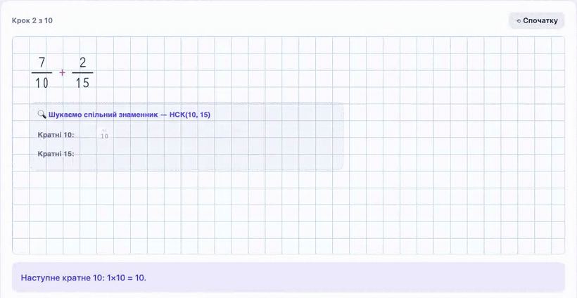

# StepBy School

Освітній портал українською: шкільні предмети й гуртки **крок за кроком**. Для учня — інтерактивні інструменти, що показують розв'язання так, ніби його пишуть від руки на зошиті в клітинку. Для вчителя — КТП, конспекти уроків і схеми на проєктор.

**▶ Відкрити портал: [vmyronovych.github.io/stepby-school](https://vmyronovych.github.io/stepby-school/)**



## Що всередині

Зараз на порталі такі предмети й гуртки (інші в розробці):

- **Математика 5–6 і 10 класів** — додавання, віднімання, множення й ділення в стовпчик, дільники і кратні, розкладання на прості множники, НСД і НСК, дії з дробами, рівняння, пропорції, область визначення функції, ірраціональні рівняння. Кожен інструмент приймає власну умову.
- **Інформатика 3–4 класів (НУШ)** — КТП на 2026/2027, конспекти уроків для вчителя, файл для НІТ і схеми на проєктор: клавіатура та навчальна копія Windows 10/11.
- **Гурток робототехніки (3–4 кл.)** — поурочні плани і конструктор електричного кола зі схемою та макеткою.
- **Курс веброзробки для підлітків** — 13 тем: від першої HTML-сторінки до посилань і таблиць. Футбольний сайт і детективне бюро як самостійні роботи. Наочні пояснення, сорок завдань і два власні міні-проєкти, зразки результатів та редактор із переглядом. Картинки можна завантажити окремо або ZIP-комплектом. Зберігайте домашню роботу як HTML-файл для роботи офлайн.

## Запуск

Для перегляду відкрийте `index.html` у браузері. Працюють `file://`, GitHub Pages і офлайн-режим.
Локальний React-бандл уже є в `assets/`. CDN і бекенд не потрібні.

Для розробки потрібен Node.js 22 або новіший:

```sh
npm ci
npm run dev
```

Відкрийте `http://127.0.0.1:5173`. Зміни в `src/` автоматично перебудовуються; оновіть сторінку після зміни.

```sh
npm run format         # форматування TypeScript і JSX
npm run build          # strict TypeScript + production-бандл
npm test               # математичні перевірки та маршрути
npx playwright install chromium
npm run test:browser   # перевірки UI у Chromium
```

Після змін React-коду додайте до коміту оновлені `assets/app.js` та `assets/app.js.LEGAL.txt`.
Якщо змінено ресурси з параметром `?v=`, оновіть їхню версію в `index.html`.

## React і TypeScript

React керує всіма публічними сторінками: навігацією, формами, документами та інтерактивними панелями.
Новий UI, дані, маршрути й стан написані на strict TypeScript. `index.html` завантажує один локальний бандл.

- `src/app/` — кореневий компонент, стан, дії, шапка й повідомлення.
- `src/navigation/` — типізовані hash-маршрути та підписи; адреси `#/…` збережено.
- `src/data/catalog.ts` — класи, предмети, теми та завдання.
- `src/features/student/` — екрани вибору й картки навчальних матеріалів.
- `src/features/tools/` — зошит, кроки, анімаційний хук і React-форми всіх 17 інструментів.
- `src/features/documents/` — зміст, статті, друк, поля КТП та перегляд схем.
- `src/features/geometry/` — досліди з векторами, керування SVG і практичні задачі.
- `src/features/keyboard/` — клавіатура, редактор тексту, пресети й обробка клавіш.
- `src/features/windows/` — робочий стіл, Провідник, меню, діалоги й вікна програм.
- `src/features/circuit/` — панель деталей, властивості, історія й оболонка SVG-поля.
- `src/components/` — спільні кнопки, картки, навігація та зошит.
- `src/runtime/` — типізований API математичних моделей і спеціалізованих двигунів.
- `src/engines/core/` — точні числа, AST формул, гліфи, зошит, числова пряма й реєстр.

Усі джерела застосунку написані на strict TypeScript зі звичайними ES-імпортами.
Математика, SVG, фізика кола та файлові операції містяться в `engines/` або `engine/` відповідної функції.
`src/runtime/index.ts` один раз збирає інструменти й документи та перевіряє унікальність їхніх ID.
Тести імпортують реалізації без виконання вихідного коду у VM.
Текст уроків і статичні SVG залишаються довіреними матеріалами. Для них передбачено `LegacyHtml`.
Не передавайте туди неекрановане введення користувача. React-компоненти отримують типізовані props.

Каталог `js/`, конкатенацію джерел, патчі вихідного тексту й віртуальний модуль двигунів видалено.
Компоненти не залежать від браузерних глобальних `DB`, `S` або `render`.
Для вбудовування й перевірок доступний малий API `StepBySchool`:
`navigate`, `changeStep`, `getSnapshot`, `getCatalog`, `getToolDefinition`, `hrefTopic`, `hrefTool`.
Цей API не потрібен самим компонентам застосунку.

Новий UI додавайте у відповідну папку `src/features/`. Не змінюйте `assets/` вручну.
Після змін `scripts/build.mjs` перезапустіть `npm run dev`.
Решта змін `src/` перебудовується автоматично; оновіть вкладку після зміни.

Як усе влаштовано, вимоги до анімації й перевірка змін — у [CLAUDE.md](CLAUDE.md).

## Перевірка ірраціональних рівнянь

Математичні перевірки після `npm ci`:

```sh
node --test tests/irrational.test.cjs
```

Урок: `#/10a/math/irrational`. Під коренем підтримуються многочлени до x².
Для квадратного кореня справа може бути лінійний вираз або квадратний корінь.
Для кубічного — число або кубічний корінь після перенесення доданків.
Введення кубічного кореня: `root(3, x - 1)`, `cbrt(x - 1)` або `∛(x - 1)`.
Рівняння третього степеня після піднесення та змішані показники коренів поки не підтримуються.

Для методу заміни виберіть «Заміна t = √x». Приклад: `x - 3sqrt(x) + 2 = 0`.
Інструмент розв’язує квадратне рівняння відносно t, відкидає t < 0 та повертається до x = t².
