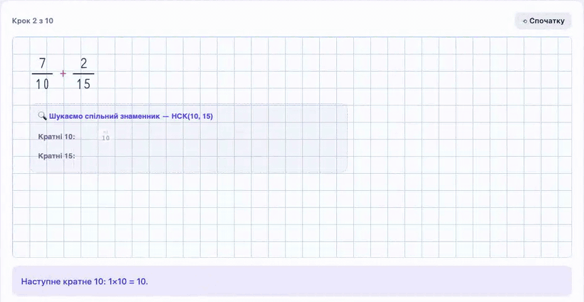

# StepBy School

Освітній портал українською: шкільні предмети й гуртки **крок за кроком**. Для учня — інтерактивні інструменти, що показують розв'язання так, ніби його пишуть від руки на зошиті в клітинку. Для вчителя — КТП, конспекти уроків і схеми на проєктор.

**▶ Відкрити портал: [vmyronovych.github.io/stepby-school](https://vmyronovych.github.io/stepby-school/)**



## Що всередині

Зараз на порталі такі предмети й гуртки (інші в розробці):

- **Медіаграмотність (1–4 класи)** — чотири теми й урок про Robux: показ «Разом у класі», окрема «Практика учня» та докладні матеріали для вчителя. Курс доступний із головної сторінки. [Походження матеріалів](docs/media-literacy-sources.md).
- **Математика 5–6 і 10 класів** — додавання, віднімання, множення й ділення в стовпчик, дільники і кратні, розкладання на прості множники, НСД і НСК, дії з дробами, рівняння, пропорції, область визначення функції, ірраціональні рівняння. Кожен інструмент приймає власну умову.
- **Інформатика 3–4 класів (НУШ)** — КТП на 2026/2027, конспекти уроків для вчителя, файл для НІТ і схеми на проєктор: клавіатура та навчальна копія Windows 10/11.
- **Робототехніка (3–4 кл.)** — 32 заняття від першого кола до «Мандрівника» на ESP32, окрема сторінка інструментів. Усі заняття мають режими «Разом у класі», «Практика в парі», матеріали вчителя та окрему учнівську сторінку. Для програмування є зображення блоків і монтажні схеми з Mcar, для пояснень — інтерактивне «Електричне коло» та ілюстрації. Доступні 73 навчальні файли `.mcar`. Збережені конструктор кола, Морзе та попередні матеріали перших електричних дослідів. [Послідовність курсу й обмеження схем](src/courses/robotics/docs/course.md).
- **Курс веброзробки для підлітків** — 27 тем: від першої HTML-сторінки до медіа, адаптивності та CSS-анімацій. Детективне бюро, футбольний сайт, мапа відкриттів і добірка фактів про Місяць як самостійні роботи. Наочні пояснення, 76 завдань і чотири власні міні-проєкти, зразки результатів та редактор із переглядом. Картинки й навчальні медіафайли можна завантажити окремо або ZIP-комплектом. Зберігайте домашню роботу як HTML-файл для роботи офлайн. У темі зовнішнього CSS є окремий редактор і завантаження style.css. Третій міні-проєкт підтримує редагування, збереження й відкриття чотирьох файлів.

## Запуск

Для розробки потрібен Node.js 22 або новіший:

```sh
npm ci
npm run dev
```

Відкрийте `http://127.0.0.1:5173`. Сервер показує `dist/`; зміни коду, HTML, CSS та матеріалів автоматично перебудовуються. Після зміни оновіть сторінку. Після зміни скриптів збірки перезапустіть сервер.

Для готової офлайн-копії:

```sh
npm run build
open dist/index.html   # macOS; на інших ОС відкрийте цей файл у браузері
```

Можна скопіювати всю папку `dist/` на інший комп’ютер: Node.js, репозиторій та інтернет для перегляду не потрібні. Кореневий `index.html` — вихідний шаблон, а не готовий сайт.

```sh
npm run preview        # показ уже зібраного dist через локальний HTTP
npm run format         # форматування TypeScript і JSX
npm test               # спочатку збірка, потім усі модульні перевірки
npx playwright install chromium
npm run test:browser   # збірка й перевірки готового сайту у Chromium
```

`dist/` виключено з Git. Комітьте вихідний код і канонічні навчальні матеріали; не комітьте бандл, опубліковані копії чи вміст `dist/`. Публічні адреси `assets/...` збережені всередині готового сайту. [Збірка та публікація на GitHub Pages](docs/deployment.md).

## React і TypeScript

React керує всіма публічними сторінками: навігацією, формами, документами та інтерактивними панелями.
Новий UI, дані, маршрути й стан написані на strict TypeScript. `dist/index.html` завантажує один локальний бандл.

- `src/app/` — кореневий компонент, стан, дії, шапка й повідомлення.
- `src/navigation/` — типізовані hash-маршрути та підписи; адреси `#/…` збережено.
- `src/data/catalog.ts` — класи, предмети, теми та завдання.
- `src/features/student/` — екрани вибору й картки навчальних матеріалів.
- `src/courses/robotics/` — каталог занять та інструментів робототехніки, показ заняття, парна практика й матеріали вчителя.
- `src/features/tools/` — зошит, кроки, анімаційний хук і React-форми 17 математичних інструментів.
- `src/features/documents/` — зміст, статті, друк, поля КТП та перегляд схем.
- `src/features/geometry/` — досліди з векторами, керування SVG і практичні задачі.
- `src/features/keyboard/` — клавіатура, редактор тексту, пресети й обробка клавіш.
- `src/features/windows/` — робочий стіл, Провідник, меню, діалоги й вікна програм.
- `src/courses/robotics/tools/circuit/` — панель деталей, властивості, історія й оболонка SVG-поля.
- `src/components/` — спільні кнопки, картки, навігація та зошит.
- `src/runtime/` — типізований API математичних моделей і спеціалізованих двигунів.
- `src/engines/core/` — точні числа, AST формул, гліфи, зошит, числова пряма й реєстр.

Усі джерела застосунку написані на strict TypeScript зі звичайними ES-імпортами.
Математика, SVG, фізика кола та файлові операції містяться в `engines/` або `engine/` відповідної функції.
`src/runtime/index.ts` один раз збирає інструменти й документи та перевіряє унікальність їхніх ID.
Тести імпортують реалізації без виконання вихідного коду у VM.
Текст уроків і статичні SVG залишаються довіреними матеріалами. Для них передбачено `LegacyHtml`.
Не передавайте туди неекрановане введення користувача. React-компоненти отримують типізовані props.

Каталог `js/`, конкатенацію джерел, патчі вихідного тексту й віртуальний модуль двигунів видалено.
Компоненти не залежать від браузерних глобальних `DB`, `S` або `render`.
Для вбудовування й перевірок доступний малий API `StepBySchool`:
`navigate`, `changeStep`, `getSnapshot`, `getCatalog`, `getToolDefinition`, `hrefTopic`, `hrefTool`.
Цей API не потрібен самим компонентам застосунку.

Робототехніка повністю розміщена в `src/courses/robotics/`: заняття, інструменти, джерела матеріалів, стилі, генератори, тести та правила для AI. [Структура курсів](docs/course-structure.md) пояснює власність файлів і публічні входи; [правила робототехніки](src/courses/robotics/CLAUDE.md) містять локальні вимоги й скіли. Інші курси поки зберігають свої чинні шляхи.

Новий UI додавайте до його курсу або відповідної наявної області. Не змінюйте `dist/` вручну: збірка публікує матеріали курсу за попередніми адресами. `npm run test:robotics` запускає локальні перевірки; `npm test` і `npm run test:browser` охоплюють також інші курси.
Після змін `scripts/build.mjs` перезапустіть `npm run dev`.
Решта змін `src/` перебудовується автоматично; оновіть вкладку після зміни.

Як усе влаштовано, вимоги до анімації й перевірка змін — у [CLAUDE.md](CLAUDE.md).

## Перевірка ірраціональних рівнянь

Математичні перевірки після `npm ci`:

```sh
node --test tests/irrational.test.cjs
```

Урок: `#/10a/math/irrational`. Під коренем підтримуються многочлени до x².
Для квадратного кореня справа може бути лінійний вираз або квадратний корінь.
Для кубічного — число або кубічний корінь після перенесення доданків.
Введення кубічного кореня: `root(3, x - 1)`, `cbrt(x - 1)` або `∛(x - 1)`.
Рівняння третього степеня після піднесення та змішані показники коренів поки не підтримуються.

Для методу заміни виберіть «Заміна t = √x». Приклад: `x - 3sqrt(x) + 2 = 0`.
Інструмент розв’язує квадратне рівняння відносно t, відкидає t < 0 та повертається до x = t².


## Медіаграмотність

Курс: `#/media/literacy`. Теми: `truth`, `publishing`, `games`, `safety`.
Урок Robux: `#/media/literacy/safety/robux`.

За замовчуванням відкривається «Разом у класі» для проєктора. Непомітне посилання внизу веде до матеріалів учителя. «Перейти до практики» показує QR-код із публічною базою `https://vmyronovych.github.io/stepby-school/` та маршрутом практики поточного уроку. Для локальних тестів `file://` і сервер на `localhost` або loopback-адресі зберігають поточний шлях. Інший пристрій не може відкрити файл з комп’ютера вчителя: для учнів використовуйте опубліковану адресу.

Маршрути `#/media/literacy/truth/student` та `#/media/literacy/safety/robux-student` показують лише практику. Це спрощення навігації, а не обмеження доступу. У практиці — 21 окрема ситуація на навички з демонстрації, вибір дії й пояснення та повторні спроби. Стан зберігається лише в пам’яті вкладки.

Навчальні правила для подальших змін збережено в [окремому документі](docs/media-literacy-guidelines.md). [Походження ілюстрацій і збережені промпти](docs/media-literacy-sources.md) описано окремо. Ліцензія QR-бібліотеки — `src/features/media-literacy/assets/qr-LICENSE.txt`.
