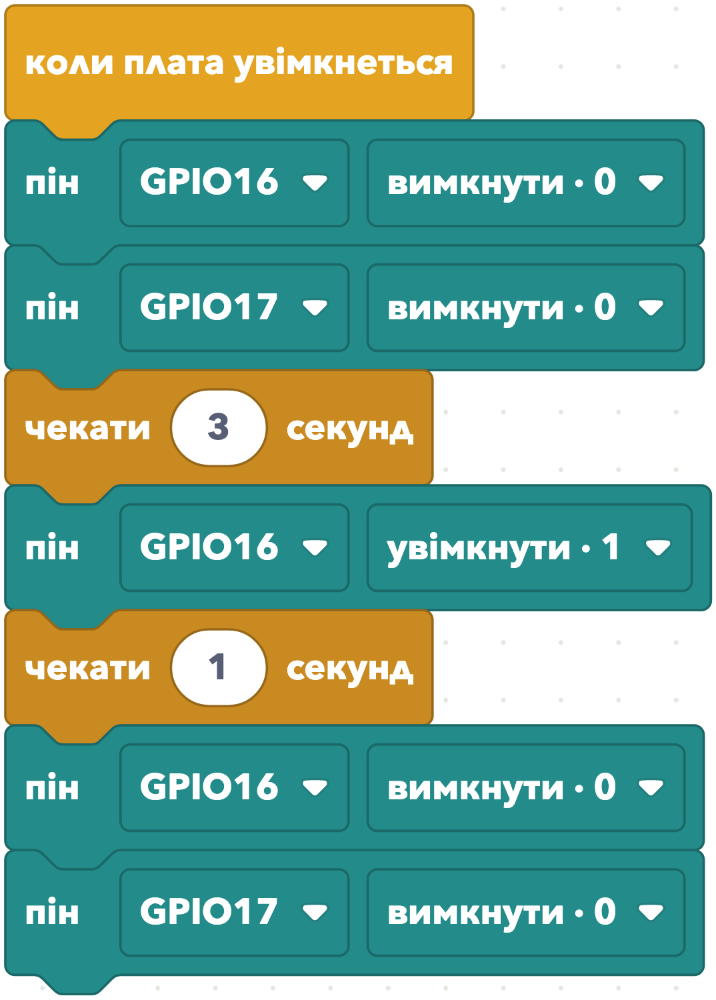
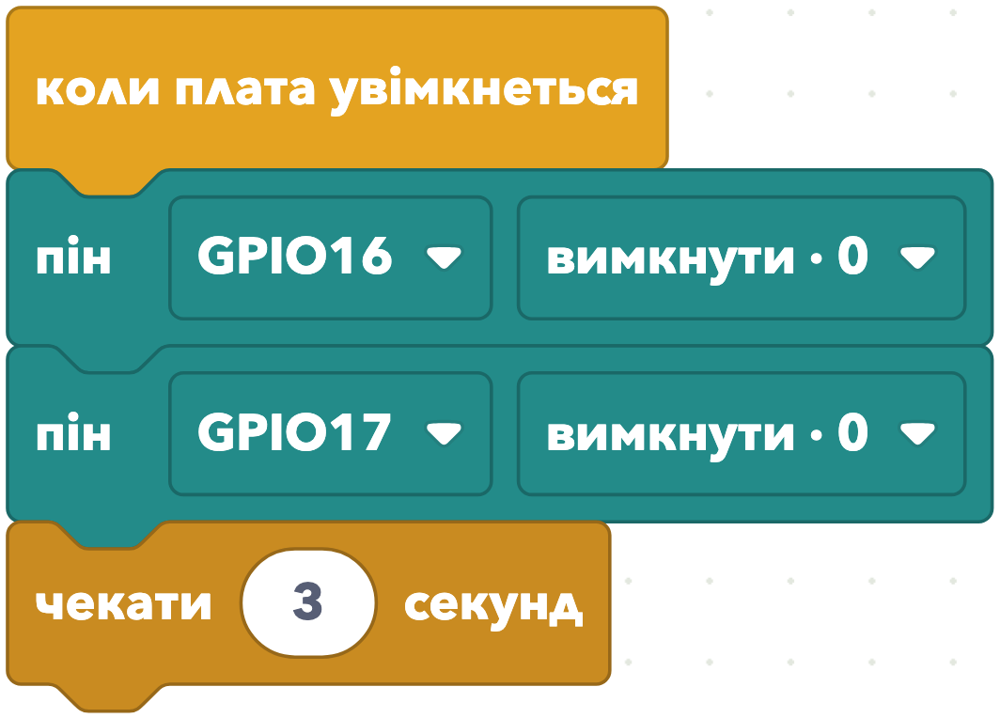

# Заняття 8 Запускаємо та зупиняємо мотор

Повний зміст трьох режимів одного заняття. На сайті кожен режим відкривається окремо; матеріали вчителя та файли з розв’язками не виводяться на учнівський екран.

**Текст картки:** Запрограмуємо коротке обертання одного піднятого колеса й змінимо тривалість роботи.

**Перед заняттям:** на заняттях 4–5 діти зібрали шасі та закріпили мотори. На 6 вони створили один спалах LED за послідовністю «увімкнути — почекати — вимкнути», дізналися про GPIO та стани 0/1, зберегли, повторно відкрили й завантажили `.mcar`. На 7 познайомилися з драйвером і підготували підключення одного каналу. Тут переносимо знайомі команди на мотор; цикли, змінні, дробові секунди й власні блоки ще не потрібні.

## Разом у класі

### Що сьогодні зробимо

«Навчимо одне колесо обертатися стільки часу, скільки ми задамо. Потім заберемо команду руху. Машинка стоятиме на підставці, щоб колесо могло вільно обертатися».

Наприкінці кожен із вас зможе показати, звідки мотор отримує енергію, який провід передає команду та який блок визначає тривалість роботи.

### Звідки приходять команда та енергія

«ESP32 передає команду драйверу. Драйвер керує енергією від батарей до мотора. USB живить ESP32; батареї живлять мотор через драйвер. Між пристроями є спільна земля GND».

Покажіть на схемі шлях команди й окремо шлях енергії до мотора. Коли всі знайшли їх, покажіть ці самі з’єднання на машинці.

Схема отримана зі стартового проєкту в редакторі підключень Mcar. Підписи підключених контактів залишено видимими. Звіряйте їх із маркуванням своїх плат; збільште зображення за потреби.

### Передбачаємо результат

Для цього досліду GPIO17 залишається вимкненим. GPIO16 передає команду першому входу драйвера.

Покажіть блоки демонстраційного файлу Mcar:

До запуску дайте дітям передбачити: коли почне обертатися колесо, скільки триватиме команда і що станеться після неї. Пояснення відкривайте після їхніх відповідей.

**Пояснення після спроби:** команда почнеться після початкової паузи й триватиме одну секунду. Коли обидва входи вимкнені, драйвер перестає обертати мотор. Колесо може ще коротко докручуватися за інерцією.

### Спостерігаємо

Учитель запускає демонстрацію на підставці. Діти дивляться на колесо; торкатися його під час роботи не потрібно. Проведіть другий запуск, щоб перевірити прогноз.

Обговоріть три речі по черзі: який блок дає час підготуватися; який визначає тривалість обертання; які команди завершують роботу. Залиште схему доступною для повернення.

### Переходимо до практики

«Тепер ваше завдання: після такої самої початкової паузи подати команду на дві секунди, а потім вимкнути мотор. Перед перевіркою поясніть напарнику, що ви очікуєте побачити».

Кнопка переходу відкриває «Практику в парі» цього заняття. Поруч доступне посилання на [майстерню Мандрівника](https://vmyronovych.github.io/stepby-robotics/).

## Практика в парі

### Ваша задача

Після запуску програми колесо чекає 3 секунди, отримує команду обертатися 2 секунди, після чого команда вимикається. Кожен із вас має змінити програму й пояснити одну зі змін.

### Підготуйте робоче місце

- Ваша машинка на стійкій підставці з вільним колесом.
- ESP32 на 38 контактів у платі розширення ESP32S 38P/4, підготовлений драйвер DRV8833 HW-627 та один підключений мотор.
- Перевірене батарейне живлення моторів із вимикачем, підготовлені проводи й USB-кабель для даних.
- Шкільний комп’ютер із майстернею «Мандрівник».

Інші моторні виходи для цього досліду не підключені до моторів. Стан решти машинки перед заняттям готує вчитель. Телефон сьогодні не потрібний.

### Звірте підключення

Вимкніть батарейне живлення моторів та від’єднайте USB перед змінами проводів. Один учасник знаходить з’єднання на схемі, інший — на машинці. Потім поміняйтеся ролями.

| Звідки                                                 | Куди            | Для чого                                |
| ------------------------------------------------------ | --------------- | --------------------------------------- |
| GPIO16 · S плати розширення                            | IN1 драйвера    | Перша команда                           |
| GPIO17 · S плати розширення                            | IN2 драйвера    | Друга команда; у цьому досліді вимкнена |
| GND окремої гребінки плати розширення                  | GND драйвера    | Спільна земля                           |
| Підготовлений плюс батарейного живлення після вимикача | VCC драйвера    | Енергія для мотора                      |
| Мінус батарейного живлення                             | GND драйвера    | Зворотний шлях живлення                 |
| OUT1 драйвера                                          | Провід A мотора | Перший провід мотора                    |
| OUT2 драйвера                                          | Провід B мотора | Другий провід мотора                    |
| USB комп’ютера                                         | USB самої ESP32 | Живлення плати та завантаження програми |

**Точка перевірки:** перед першим запуском покажіть підключення вчителю. Налаштовані дорослим контакти SLEEP та захист живлення не змінюємо. Проводи мотора підключаються до OUT драйвера; до GPIO мотор не під’єднуємо.

### Відкрийте свій проєкт

1. Збережіть попередню роботу у файл.
2. Завантажте [старт заняття 8](files/lesson-08-start.mcar).
3. У майстерні натисніть «Відкрити» та оберіть завантажений файл. Перевірте, що відкрився проєкт «Заняття 08 — старт».
4. У «Підключеннях» знайдіть той самий драйвер, один мотор та GPIO16 і GPIO17. Стартовий файл уже містить схему.
5. Поверніться до блоків. Початкова послідовність вимикає два входи й чекає 3 секунди. Команд обертання в ній поки немає.

Додайте власне продовження. Після складання назвіть проєкт, наприклад «Пара 2 — мотор 2 секунди», і збережіть його у свою папку.

### Підказки

На учнівській сторінці кожна наступна підказка відкривається окремою дією. Почніть із власної спроби.

**Підказка 1 — задум.** Вам потрібні три частини: дати команду мотору, залишити її на потрібний час, забрати команду.

**Підказка 2 — де шукати.** У категорії «Піни» є «пін … увімкнути · 1» і «пін … вимкнути · 0». У «Керуванні» — «чекати … секунд». Для першого входу драйвера на нашій схемі використано GPIO16. GPIO17 залишається вимкненим.

**Підказка 3 — частина програми.** Після початкової паузи додайте «пін GPIO16 увімкнути · 1». Тепер визначте, де потрібне очікування двох секунд і які команди мають бути останніми. Напарник пояснює запропонований порядок перед запуском.

### Запустіть і перевірте

Проводку вже перевірив учитель. Колеса підняті, дроти не торкаються рухомих частин.

1. Залиште живлення моторів вимкненим. Підключіть USB до ESP32 й завантажте власну програму кнопкою «Прошити програму».
2. Дочекайтеся завершення завантаження. Увімкніть перевірене батарейне живлення моторів на підставці.
3. За вказівкою вчителя коротко натисніть кнопку EN/RESET на ESP32. Вона запускає записану програму з початку. Кнопка BOOT для цього не потрібна.
4. Спостерігайте: спочатку пауза, потім коротке обертання, потім припинення команди. Перед будь-якою зміною проводів знову вимкніть обидва джерела живлення.

Перевірте разом:

- До завершення початкової паузи колесо не отримує команди обертатися.
- Команда триває приблизно дві секунди. Звіряємо її тривалість, а не точний момент повної механічної зупинки.
- Після виконання програми мотор не продовжує працювати.
- Після перезапуску послідовність повторюється один раз.
- Обоє можуть показати блок, що визначає дві секунди, та команди вимкнення.

Ці спостереження робите ви. Сторінка сама не вимірює роботу фізичного мотора.

### Поміняйтеся ролями

Другий учасник змінює тривалість команди на 3 секунди, зберігає й завантажує програму. Перший передбачає різницю та перевіряє результат. Перед кожним завантаженням моторне живлення вимкнене; після нього повторіть той самий порядок запуску на підставці.

Поясніть одне одному, чому початкові 3 секунди залишилися незмінними. За потреби поверніть програму до задачі на 2 секунди й збережіть остаточний файл.

### Якщо вже готові

Зробіть два короткі запуски по 1 секунді з паузою 2 секунди між ними. Між запусками обидва входи мають бути вимкнені. Поки можна скласти знайомі блоки послідовно; цикл вивчатимемо пізніше.

На екрані покажіть у програмі порядок «рух — пауза — рух — вимкнення». Напарник до запуску називає тривалість кожного етапу та перевіряє вимкнення обох входів під час паузи.

### Якщо щось не працює

- **Колесо не обертається.** Після завершення завантаження увімкнули моторне живлення й перезапустили програму? Чи справді в блоці обрано GPIO16? Якщо цього недостатньо, вимкніть живлення й покличте вчителя для перевірки проводів.
- **Не припиняє обертатися.** Вимкніть моторне живлення. Перевірте, чи наприкінці послідовності є команди вимкнення обох входів і чи останні зміни вже завантажені на плату.
- **Програма змінилася на екрані, а мотор працює як раніше.** Після редагування потрібно знову завантажити програму. Збереження у файл саме по собі не змінює програму в ESP32.

### Завершіть роботу

Вимкніть моторне живлення, від’єднайте USB й збережіть свій `.mcar`. Кожен коротко пояснює одну річ: звідки береться енергія для мотора; що робить драйвер; який блок змінює час. На наступному занятті-майстерні можна завершити незакінчену роботу.

## Матеріали для вчителя

### Результат і межі заняття

Діти керують одним каналом драйвера: початкові 0/0, команда 1/0, завершальні 0/0. Цього достатньо для досліду з тривалістю. Зміну напрямку вводимо на занятті 10, ШІМ — на занятті 13. Програмна команда «вимкнути» не означає миттєвого гальмування колеса.

Перед показом попросіть кожного учасника знайти на знайомій програмі LED початок, увімкнення, очікування й вимкнення. Якщо послідовність ще незрозуміла, спочатку повторіть один спалах без мотора; потім поверніться до перенесення тієї самої ідеї. Для звільнення часу можна пропустити ускладнення, зберігши основну практику й зміну ролей.

У DRV8833 стан 0/0 відпускає виходи, тому колесо може докручуватися за інерцією. Стан 1/0 задає один напрямок; назва «вперед» для всієї машинки залежить від монтажу й буде визначена пізніше. Логіка підтверджена [таблицею керування DRV8833 від Texas Instruments, розділ 7.3.2](https://www.ti.com/lit/ds/symlink/drv8833.pdf).

### Підготовка до заняття

Для кожної пари підготуйте підставку, одну доступну для огляду моторну пару проводів і перевірений канал HW-627. У цьому прикладі використовується ESP32 на 38 контактів, встановлена в плату розширення ESP32S 38P/4, із GPIO16 → IN1 та GPIO17 → IN2. Перед проведенням звірте цю схему з вашим комплектом. Якщо у вашій машинці інші GPIO, узгоджено змініть схему, стартовий файл і всі приклади до початку заняття.

Використовуйте підготовлений технічним помічником драйвер у робочому стані. На конкретному HW-627 він має заздалегідь перевірити SLEEP, захист та живлення. Схема заняття не задає нової перемички SLEEP або J1 і не замінює підготовку модуля. Невикористані моторні виходи залиште без підключених моторів.

ESP32 у цьому досліді живиться тільки через власний USB. Підготовлена батарейна гілка живить VCC драйвера; GND спільна. Зовнішній плюс не під’єднується до 5V ESP32 чи до ряду V плати розширення. Якщо комплект уже має зовнішнє живлення ESP32, технічний помічник готує конфігурацію для цього USB-досліду заздалегідь.

Перевірте старт і два вчительські файли на вашій підставці до заняття. Після цього завантажте безпечний старт, що лише вимикає входи, й вимкніть моторне живлення. Для показу підготуйте окрему машинку або використайте одну з шести до початку роботи пар. Інтернет потрібен для відкриття опублікованої майстерні; перевірте її доступність і USB-завантаження на шкільних комп’ютерах.

### Файли

- [Старт для учнів](files/lesson-08-start.mcar): схема та початкове вимкнення з паузою; команд обертання немає.
- [Демонстрація для вчителя](files/lesson-08-demo.mcar): команда на 1 секунду.
- [Приклад розв’язку для вчителя](files/lesson-08-solution.mcar): команда на 2 секунди.

Демонстрацію та розв’язок не додавайте до учнівського режиму. Дитина може створити іншу коректну програму з тією самою поведінкою; не вимагайте однакової розкладки блоків.

### Перша частина заняття

**0–5 хв. Підготовка пар.** Назвіть результат, розподіліть ролі й перевірте, що моторне живлення вимкнене. Нагадайте: програма запускається після завантаження або перезапуску плати.

**5–12 хв. Команда та енергія.** Покажіть схему. Попросіть дітей простежити GPIO16 → IN1 й окремо батареї → драйвер → мотор. Поясніть драйвер як пристрій, що за командою контролера керує живленням мотора.

**12–20 хв. Прогноз і демонстрація.** Покажіть програму на 1 секунду. Дайте дітям передбачити результат, проведіть два запуски та обговоріть, чому колесо може ще трохи рухатися після вимкнення команди.

**20–35 хв. Звіряння підключень.** Пари перевіряють свої схеми без живлення. Послідовно огляньте всі шість комплектів. Пари, що чекають перевірки, відкривають стартовий файл і проговорюють задум програми без запуску моторів.

**35–45 хв. Власна програма.** Діти складають продовження на 2 секунди, починаючи з власної спроби. Підказки відкривають за потреби. Допомагайте запитанням про задум перед тим, як указувати блок.

Перед 10-хвилинною перервою вимкніть моторне живлення всіх пар. Перерва не входить до 90 хв навчального часу.

### Друга частина заняття

**0–5 хв. Повернення до задуму.** Кожна пара пояснює очікувану послідовність. Повторіть порядок запуску після завантаження.

**5–20 хв. Випробування.** Пари запускають програму та звіряють спостереження. Якщо рух не відповідає задуму, спочатку вимикають моторне живлення, потім аналізують програму чи проводку.

**20–30 хв. Зміна ролей.** Другий учасник змінює тривалість на 3 секунди. Перший прогнозує поведінку. Перевірте, що обоє знають різницю між початковою паузою та тривалістю команди: навіть коли обидва числа дорівнюють 3, ці очікування стоять у різних місцях послідовності.

**30–38 хв. Доробка або ускладнення.** Основне завдання — завершити й пояснити контрольований запуск. Готові пари створюють два короткі запуски з паузою. Якщо пара не встигла, позначте конкретний незавершений крок для заняття 9.

**38–43 хв. Обговорення.** Запросіть кілька пар показати результат. Кожній дитині поставте одне коротке запитання про її роботу. Не оцінюйте розуміння лише за працездатністю спільної машинки.

**43–45 хв. Збереження й завершення.** Кожна пара зберігає `.mcar` у свою папку, вимикає моторне живлення та від’єднує USB. Перевірте назви файлів і підписані комплекти.

### Повний приклад програми

Блоки з учительського файлу, відкритого в Mcar. У редакторі ви побачите ті самі кольори, форми й поля.

У демонстраційному файлі друге очікування дорівнює 1 секунді. Стартовий файл містить лише початок до завершення початкового очікування. Приклад для готових пар: після стартової паузи увімкнути GPIO16 на 1 секунду, вимкнути обидва входи на 2 секунди, повторно увімкнути GPIO16 на 1 секунду, завершити вимкненням обох входів. GPIO17 увесь дослід лишається вимкненим.

### Як пояснювати типові труднощі

| Спостереження                            | Що перевірити                                                                              | Як допомогти дитині                                                                            |
| ---------------------------------------- | ------------------------------------------------------------------------------------------ | ---------------------------------------------------------------------------------------------- |
| Немає руху                               | Чи ввімкнене моторне живлення; чи повторно запущена програма; чи збігаються GPIO зі схемою | «Покажи, де програма дає команду. Чи доходить вона саме до цього входу?»                       |
| Команда вже завершилася до спостереження | Після завантаження програма могла виконатися з вимкненими батареями                        | «Запустімо записану програму з початку кнопкою EN/RESET після підготовки».                     |
| Мотор працює без завершення              | Чи є вимкнення, чи завантажені останні зміни                                               | Спочатку вимкнути живлення; потім попросити простежити послідовність до останнього блока.      |
| Після вимкнення колесо докручується      | Це може бути інерція, а не нова команда                                                    | «Чи мотор і далі підтримує рух, чи колесо поступово зупиняється?»                              |
| У двох пар різний напрямок               | Розташування мотора й порядок його проводів                                                | Цього разу оцінюємо керовану тривалість. Не називаємо цей напрямок «вперед» для всіх машинок.  |
| Зміна числа не дає нового результату     | Чи змінене саме друге очікування; чи виконане повторне завантаження                        | «Яке з двох очікувань ти змінив? Покажи його місце відносно команди ввімкнення».               |
| Плата перезапускається під час руху      | Живлення, з’єднання й моторний канал має перевірити дорослий                               | Вимкнути дослід, дати парі підготовлений запасний комплект; не доручати дітям ремонт живлення. |

### Що має пояснити кожна дитина

Попросіть показати на власній програмі: «Що змінити, щоб команда тривала довше?» Потім на схемі: «Звідки мотор отримує енергію?» Або про завершення: «Що станеться, якщо забути вимкнення?»

Достатньо короткого пояснення своїми словами з показом потрібного блока чи проводу. Учень, який лише повторив дії напарника, отримує ще одну спробу змінити тривалість і передбачити результат.

### Перевірка матеріалів

Формат `.mcar`, назви блоків, карта контактів ESP32 і позначення HW-627 взяті з поточної USB-майстерні `mcar` (базовий коміт `fa7a3dc`). Старі документи про 30-контактну плату та Pololu-драйвер не використовуються як схема цього заняття.

Фізичний «Мандрівник» із двома фінальними режимами вже випробуваний автором курсу. Нові файли саме цього заняття перевіряються окремо: програмна перевірка сумісності не є їхнім запуском на фізичному комплекті. Порядок повторення перевірки та її результат — у [звіті](verification.md).

### Монтаж на mini breadboard

HW-627 встановлюємо поперек центрального розриву mini breadboard: SLEEP/OUT1/OUT2/OUT3/OUT4/FAULT → D11/D10/D9/D8/D7/D6; IN4/IN3/GND/VCC/IN2/IN1 → H11/H10/H9/H8/H7/H6. GPIO16 → J6, GPIO17 → J7, мотор → A10/A9, моторне живлення → J8/J9, спільна GND від ESP32 → I9. Налаштування SLEEP готує дорослий. ESP32 лишається у платі розширення.
